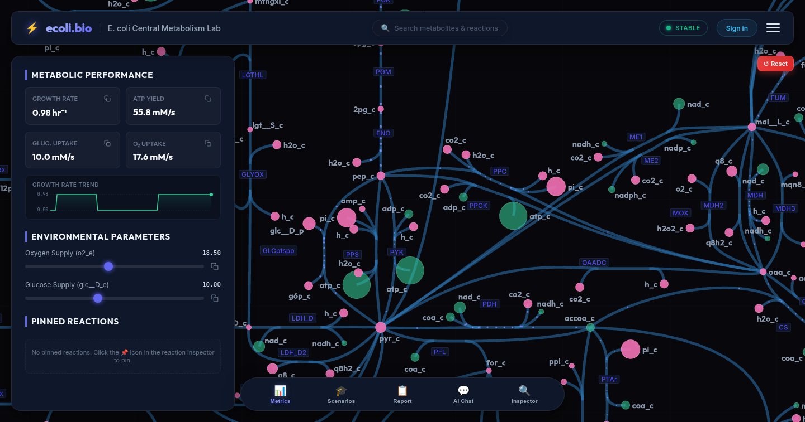
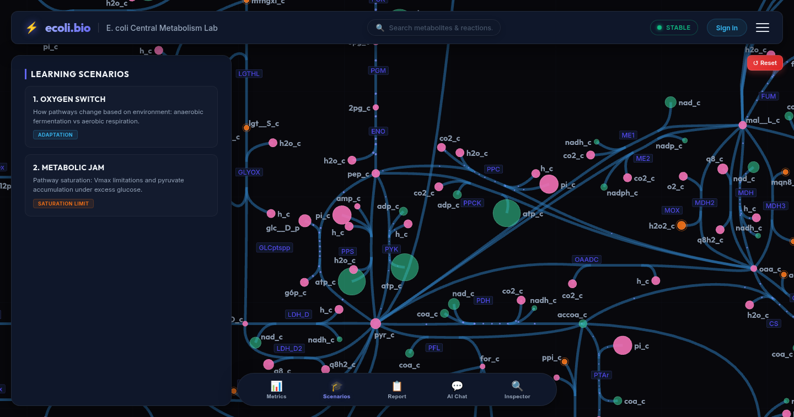
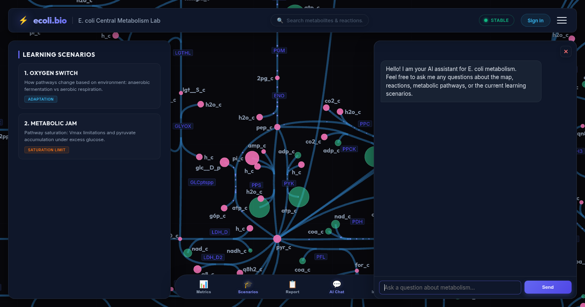

# 🧬 ecoli.bio — Interactive *E. coli* Central Metabolism Simulator

[](https://ecoli.bio)
[](https://workers.cloudflare.com/)
[-f59e0b?style=for-the-badge&logo=sqlite&logoColor=white)](https://developers.cloudflare.com/d1/)
[](https://highs.dev/)
[](https://pixijs.com/)
[](https://ai.google.dev/)
[](./LICENSE)

**Live Application:** [https://ecoli.bio](https://ecoli.bio)

`ecoli.bio` is an interactive web platform for exploring central carbon metabolism in *Escherichia coli* (based on the genome-scale **iJO1366** reconstruction) in real time. Students and researchers can adjust extracellular nutrient uptake rates, modify enzyme kinetics ($V_{\max}$ and $K_m$), trigger metabolite spikes or depletions, run guided educational scenarios, and consult a context-aware AI Metabolic Assistant.

---

## 📸 Screenshots

### 1. Real-Time Metabolic Atlas & Flux Performance


### 2. Guided Learning Scenarios & Pathway Perturbations


### 3. Context-Aware AI Metabolic Assistant


---

## ✨ Key Features

- **Real-Time Flux Balance Analysis (FBA) & Dynamic Simulation:** Solves metabolic fluxes on the fly using the **HiGHS** linear programming solver compiled to **WebAssembly**, coupled with stateful cloud synchronization.
- **Interactive Metabolic Atlas (PixiJS / HTML5 Canvas):** Smooth GPU-accelerated pan-and-zoom visualization of glycolysis, the pentose phosphate pathway, the TCA cycle, oxidative phosphorylation, and fermentation pathways with animated flux particles and live metabolite pools.
- **Enzyme Kinetics & Perturbations:** Fine-tune $V_{\max}$ and $K_m$ parameters for individual reactions (`PFK`, `PDH`, `PFL`, `ATPS4rpp`, `CYTBO3_4pp`, etc.) or apply instantaneous substrate spikes/depletions to observe homeostatic shifts.
- **Cloud-Synced Experiments (Cloudflare Durable Objects + D1):** Both registered users and guests can create, rename, switch between, and replay multiple experiment timelines with automatic state persistence.
- **Context-Aware AI Metabolic Assistant:** Powered by Google Gemini (`gemini-3.8-flash`), the assistant inspects the live simulation state, explains pathway shifts, evaluates student answers in guided scenarios, generates publication-ready academic experiment reports, and outputs clickable BiGG IDs that highlight directly on the metabolic map.

---

## 🏗️ Architecture & Tech Stack

| Layer | Technology |
|---|---|
| **Frontend & Rendering** | Vanilla JavaScript (ES Modules), Vite, PixiJS, HTML5 Canvas |
| **Optimization Solver** | HiGHS LP Solver (`highs.wasm` WebAssembly module) |
| **Edge Backend & Realtime State** | Cloudflare Workers, Cloudflare Durable Objects (`SolverDO`), WebSockets |
| **Database** | Cloudflare D1 (SQLite at the edge) with structured SQL migrations |
| **Authentication** | Google OAuth 2.0 + guest session persistence |
| **AI Integration** | Google Gemini API with server-side conversation history and multi-tier rate limiting |

---

## 📂 Repository Structure

```text
├── src/
│   ├── main.js               # Frontend UI, interactive controls, scenarios, AI chat & report modals
│   ├── renderer.js           # PixiJS / Canvas metabolic map renderer & flux animations
│   ├── simulation.js         # Client-side metabolic state & kinetics coordination
│   ├── fba_solver_worker.js  # Web Worker running the HiGHS WebAssembly solver
│   ├── worker.js             # Cloudflare Worker entry point & SolverDO Durable Object
│   └── d1_db.js              # Cloudflare D1 database queries & rate-limiting helpers
├── migrations/               # D1 SQL schema migrations (sessions, logs, credits, rate limits)
├── public/                   # iJO1366 metabolic map JSON, Escher layout & HiGHS WASM binary
├── docs/screenshots/         # Application UI screenshots
├── scripts/                  # Build-time metabolic bounds & guest state compilers
└── wrangler.toml             # Cloudflare Workers, D1 & Durable Objects configuration
```

---

## 🚀 Local Development

```bash
# Install dependencies
npm install

# Apply local D1 database migrations
npm run d1:migrate:local

# Start local Vite dev server
npm run dev

# Or run the Cloudflare Worker locally with Wrangler
npm run dev:worker
```

---

## 📄 License

This project is licensed under the [MIT License](./LICENSE).
